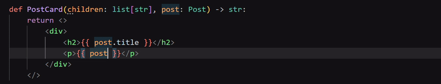

# Language Server

Type checking, completions, hover docs, go-to-definition, and rename work out of the box.




## Features

- **Diagnostics** — type errors and undefined names reported inline
- **Hover** — type information and docstrings on hover
- **Completions** — attribute, method, and name completions including trigger-on-dot
- **Semantic tokens** — type-aware syntax highlighting for Python code inside fragments
- **Syntax highlighting** — structural highlighting for `<>`, tags, and `{{ }}` interpolations
- **Go-to-definition** — jump to the definition of a symbol
- **Find references** — list all usages of a symbol
- **Rename** — rename a symbol across all files in the workspace
- **Formatting** — formats the surrounding Python with Black and leaves fragments untouched (see [Formatting](#formatting))

All features work on component names and attribute names in component tags — go-to-definition on `<Layout>` jumps to the function, rename propagates across all usages, hover shows parameter types.

Not yet implemented:

- **Fragments-specific syntax** — autocompletion and syntax highlighting for fragments blocks

## Installation

```bash
pip install python-fragments[lsp]
```

Then start the language server:

```bash
fragments-lsp
```

## Formatting

Install the `format` extra to enable formatting:

```bash
pip install python-fragments[format]
```

Python code is formatted with [Black](https://black.readthedocs.io/); everything inside `<>...</>` is left exactly as written. Files that don't currently parse are left unchanged.

### Command line and pre-commit

```bash
fragments format src/ app.py     # format files or directories in place
fragments format --check src/    # exit 1 if any file would change
fragments format --dry-run app.py # print to stdout instead of writing
```

Parse errors are reported as `path:line:column: message` and the remaining files are still formatted. Directories are searched for `*.py`, skipping hidden directories such as `.venv`.

To run it automatically on every commit, see [Pre-commit](pre-commit.md).
