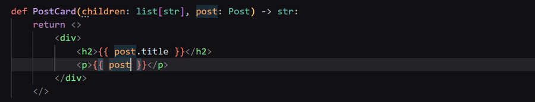

# VS Code

Type checking, completions, hover docs, go-to-definition, and rename work out of the box.



## Installation

Install the [Python Fragments extension](https://marketplace.visualstudio.com/items?itemName=tra-technologies-ltd.python-fragments) from the VS Code Marketplace.

Install the [Python extension](https://marketplace.visualstudio.com/items?itemName=ms-python.python) and select the interpreter for the environment where `python-fragments[lsp]` is installed. The extension will automatically start `fragments-lsp` from that environment.

If a conflicting Python language server (such as Pylance) is active, the extension will prompt you to disable it on first activation.

### Building from source

Bump the package version if needed:

``` bash
cd vscode-extension
npm version patch --no-git-tag-version # for a patch update
npm version minor --no-git-tag-version # for a minor update
npm version major --no-git-tag-version # for a major update
cd ..
```

To build and install the extension manually:

``` bash
npm install -g @vscode/vsce
cd vscode-extension
npm install
vsce package
code --install-extension <filename>.vsix
```

## Configuration

| Setting                | Default                             | Description                                                                                                       |
| ---------------------- | ----------------------------------- | ----------------------------------------------------------------------------------------------------------------- |
| `fragments.serverPath` | _(derived from active interpreter)_ | Override path to the `fragments-lsp` executable. Only needed if auto-detection fails.                             |
| `fragments.blackArgs`  | `""`                                | Extra [Black options](../integrations/formatting/black.md#editors) used when formatting, e.g. `-l 100 --preview`. |

## Formatting

Format on save is supported with the [Black integration](../integrations/formatting/black.md#vs-code).
